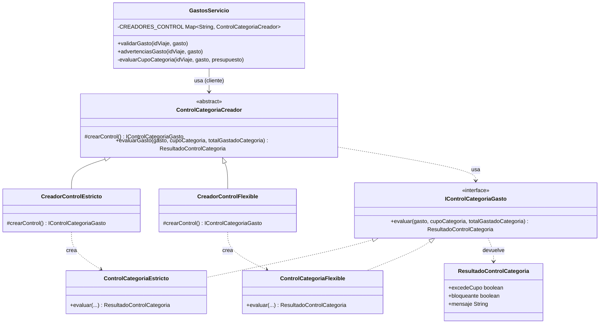

# Patrones GoF en WiseTrip - Módulo de presupuesto y gastos (HU#89)

## HU#89

> Como usuario de WiseTrip quiero que las funcionalidades de presupuesto y gastos estén correctamente integradas para gestionar la información financiera de mi viaje de forma confiable.

## 1. Factory Method — quién decide qué tan estricta es cada categoría

**Problema de diseño:** WiseTrip ya tenía el reparto del presupuesto por categoría (HU#69/#79): el viajero decide qué porcentaje va a hospedaje, alimentación, transporte, actividades e imprevistos con `RepartoPresupuesto`. Pero cuando se registra un gasto real (HU#89, `GastosServicio`), el sistema solo lo compara contra el total del presupuesto del viaje — nunca contra el porcentaje que esa categoría tenía asignado. Si mañana quisiéramos que cada categoría se controle distinto (p. ej. que "imprevistos" sea un colchón que se puede pasar, pero "hospedaje" no), sin un patrón tendríamos:

- **Alto acoplamiento:** `GastosServicio` tendría que conocer, una por una, las reglas de las cinco categorías.
- **Código rígido:** cada categoría nueva, o cada cambio de regla en una ya existente, obligaría a modificar `GastosServicio` directamente.
- **Baja cohesión:** una misma clase terminaría mezclando "¿el gasto está bien formado?" con "¿esta categoría en particular permite este monto?", que son dos preocupaciones distintas.
- **Dificultad en pruebas:** para probar que "imprevistos permite excederse" habría que montar todo `GastosServicio` con sus tres repositorios, en vez de probar esa regla sola.

**Solución directa:** un `if/else` (o `switch`) dentro de `validarGasto` que compare el monto contra el cupo de la categoría y decida a mano si bloquea o solo advierte.

Esa solución "funciona" con las cinco categorías actuales, pero no escala: la regla de cada categoría queda escondida dentro de ese mismo método, invisible para el resto del sistema, y agregar o cambiar una política significa tocar una clase que ya tiene otras responsabilidades (orquestar repositorios, calcular el resumen) y volver a probarla entera.

El Patrón Factory Method consiste en encapsular la lógica de instanciación de objetos dentro de un método o clase especializada (la "fábrica"), evitando que el código cliente utilice la palabra `new` directamente y logrando que la creación de objetos sea independiente de quién los utiliza. Aquí cada categoría tiene su propia "fábrica" que decide qué política de control usar, y `GastosServicio` nunca necesita saber cuál es.

### 1: el molde que deben cumplir todas las políticas de control

`negocio/IControlCategoriaGasto.java`

```java
public interface IControlCategoriaGasto {
    ResultadoControlCategoria evaluar(
            Gasto gasto, BigDecimal cupoCategoria, BigDecimal totalGastadoCategoria);
}
```

Nota: "cualquier cosa que quiera ser una política de control debe tener un método `evaluar`". No hace nada por sí sola.

### 2: la política estricta (hospedaje, alimentación, transporte, actividades)

Compara lo ya gastado más el nuevo gasto contra el cupo de la categoría. Si se pasa, bloquea.

`servicio/ControlCategoriaEstricto.java`

```java
public class ControlCategoriaEstricto implements IControlCategoriaGasto {

    @Override
    public ResultadoControlCategoria evaluar(
            Gasto gasto, BigDecimal cupoCategoria, BigDecimal totalGastadoCategoria) {

        BigDecimal totalConGasto = totalGastadoCategoria.add(gasto.monto());
        if (totalConGasto.compareTo(cupoCategoria) > 0) {
            return new ResultadoControlCategoria(true, true,
                    "El gasto supera el cupo asignado a '" + gasto.categoria()
                    + "' (" + cupoCategoria + " " + gasto.moneda() + ").");
        }
        return ResultadoControlCategoria.sinProblemas();
    }
}
```

### 3: la política flexible (imprevistos)

Hace la misma cuenta, pero en vez de bloquear, solo avisa. "Imprevistos" es el colchón del viaje: está pensado para absorber sorpresas.

`servicio/ControlCategoriaFlexible.java`

```java
public class ControlCategoriaFlexible implements IControlCategoriaGasto {

    @Override
    public ResultadoControlCategoria evaluar(
            Gasto gasto, BigDecimal cupoCategoria, BigDecimal totalGastadoCategoria) {

        BigDecimal totalConGasto = totalGastadoCategoria.add(gasto.monto());
        if (totalConGasto.compareTo(cupoCategoria) > 0) {
            return new ResultadoControlCategoria(true, false,
                    "Ya superaste el cupo previsto para 'imprevistos' (" + cupoCategoria
                    + " " + gasto.moneda() + "). Sigue registrado, pero vigila el resto del viaje.");
        }
        return ResultadoControlCategoria.sinProblemas();
    }
}
```

### 4: las fábricas — una por política

Este es el corazón del patrón: una clase abstracta (`ControlCategoriaCreador`) declara el **método de fábrica** `crearControl()` sin implementarlo, y un método plantilla (`evaluarGasto`) que lo usa. Cada subclase concreta decide, con su propio `crearControl()`, qué política concreta instanciar.

`negocio/ControlCategoriaCreador.java`

```java
public abstract class ControlCategoriaCreador {

    // Factory method: cada subclase decide qué Product concreto crear.
    protected abstract IControlCategoriaGasto crearControl();

    // Método plantilla: usa el Product que entregue el factory method.
    public ResultadoControlCategoria evaluarGasto(
            Gasto gasto, BigDecimal cupoCategoria, BigDecimal totalGastadoCategoria) {
        IControlCategoriaGasto control = crearControl();
        return control.evaluar(gasto, cupoCategoria, totalGastadoCategoria);
    }
}
```

`servicio/CreadorControlEstricto.java` y `servicio/CreadorControlFlexible.java`:

```java
public class CreadorControlEstricto extends ControlCategoriaCreador {
    @Override
    protected IControlCategoriaGasto crearControl() {
        return new ControlCategoriaEstricto();
    }
}

public class CreadorControlFlexible extends ControlCategoriaCreador {
    @Override
    protected IControlCategoriaGasto crearControl() {
        return new ControlCategoriaFlexible();
    }
}
```

### 5: quién usa las fábricas, sin saber cuál política hay detrás

`GastosServicio` guarda, por categoría, **qué fábrica** le corresponde. El tipo de esa variable es `ControlCategoriaCreador` (el molde), nunca `ControlCategoriaEstricto` ni `ControlCategoriaFlexible` directamente, y `GastosServicio` jamás escribe `new ControlCategoriaEstricto()` a mano.

`servicio/GastosServicio.java`

```java
private static final Map<String, ControlCategoriaCreador> CREADORES_CONTROL = Map.of(
        "hospedaje", new CreadorControlEstricto(),
        "alimentacion", new CreadorControlEstricto(),
        "transporte", new CreadorControlEstricto(),
        "actividades", new CreadorControlEstricto(),
        "imprevistos", new CreadorControlFlexible());

private ResultadoControlCategoria evaluarCupoCategoria(
        int idViaje, Gasto gasto, PresupuestoViaje presupuesto) {

    IDistribuible reparto = repositorioReparto.buscarReparto(idViaje);              // HU#69/#79
    BigDecimal cupoCategoria = BigDecimal.valueOf(
            reparto.montoDe(gasto.categoria(), presupuesto.montoTotal().doubleValue()));
    BigDecimal totalGastadoCategoria =
            repositorioGastos.totalGastadoPorCategoria(idViaje, gasto.categoria());  // HU#89

    ControlCategoriaCreador creador = CREADORES_CONTROL.get(gasto.categoria());
    return creador.evaluarGasto(gasto, cupoCategoria, totalGastadoCategoria);
}
```

`validarGasto(...)` usa el resultado para bloquear el registro cuando `bloqueante() == true`; `advertenciasGasto(...)` expone el mismo cálculo cuando no bloquea, para que la vista pueda avisar "ya superaste imprevistos" sin impedir el registro.

### ¿Cómo sabe GastosServicio cuál política usar?

**No lo sabe. `GastosServicio` nunca conoce `ControlCategoriaEstricto` ni `ControlCategoriaFlexible`.** La decisión ocurre en dos momentos distintos:

**Momento 1 — cuando se carga la clase (se arma el mapa de fábricas):**
`CREADORES_CONTROL` se construye una sola vez, asociando cada nombre de categoría con su `ConcreteCreator`. Esto pasa al cargar `GastosServicio`, no cada vez que alguien registra un gasto.

**Momento 2 — cuando llega un gasto (se busca la fábrica que le toca):**
`evaluarCupoCategoria` mira `gasto.categoria()`, busca en el mapa qué `ControlCategoriaCreador` le corresponde, y le pide que fabrique y use su política. Si la categoría es "hospedaje", sale un `ControlCategoriaEstricto`; si es "imprevistos", sale un `ControlCategoriaFlexible`. `GastosServicio` nunca decidió eso con un `if`, solo preguntó "¿quién te toca?" al mapa.

Lo importante aquí es que `GastosServicio` nunca tiene que saber los detalles de cada política — esa complejidad queda escondida dentro de cada `ControlCategoriaGasto` y su `ControlCategoriaCreador`. Si mañana se agrega una categoría nueva, o "actividades" también se vuelve flexible, el único cambio es una línea en `CREADORES_CONTROL` (o una pareja nueva de `ConcreteCreator`/`ConcreteProduct` si la regla es distinta a las dos que ya existen) — `GastosServicio` y sus pruebas no se tocan.

## Diseño - Diagrama UML



**Roles del patrón, por si quedó alguna duda:**

- **Product** (`IControlCategoriaGasto`): el molde de "una política de control".
- **ConcreteProduct** (`ControlCategoriaEstricto`, `ControlCategoriaFlexible`): las dos formas reales de controlar una categoría.
- **Creator** (`ControlCategoriaCreador`): declara el método de fábrica y el método que lo usa.
- **ConcreteCreator** (`CreadorControlEstricto`, `CreadorControlFlexible`): cada uno sabe fabricar su propio `ConcreteProduct`.
- **Cliente** (`GastosServicio`): pide la fábrica que le toca a una categoría y la usa, sin conocer las clases concretas.

---

## Pruebas

`test/com/wisetrip/servicio/GastosServicioTest.java` agrega dos casos que demuestran el comportamiento de cada política:

- `bloqueaGastoQueSuperaElCupoDeUnaCategoriaEstricta`: un gasto en "hospedaje" que supera su cupo (35% del presupuesto) es rechazado por `ControlCategoriaEstricto` y `registrarGasto` lanza excepción.
- `permiteSuperarElCupoDeImprevistosPeroAdvierte`: un gasto en "imprevistos" que supera su cupo (5%) se registra igual (no hay error bloqueante) pero `advertenciasGasto` devuelve el aviso generado por `ControlCategoriaFlexible`.
