# Diagrama de clases — Planificación e itinerario del viaje (M3)

Este diagrama muestra las clases que forman el módulo de Planificación e Itinerario del Viaje (M3), con sus atributos, sus métodos principales y cómo se relacionan. Los colores indican la capa de cada clase: morado para los controladores, verde para los servicios y amarillo para los modelos y las clases de los patrones de diseño. Las clases en gris pertenecen a otros módulos y solo aparecen para mostrar con qué se conecta este. En cada flecha se escribe el nombre del atributo que guarda la relación y cuántos objetos participan.

El flujo de planificación lo maneja `PlanificacionControlador`. Para las preferencias usa `GestorPreferencias`, que implementa `PreferenciasServicio`: arma el cuestionario con 9 categorías (`CategoriaPreferencia`), cada una con sus preguntas (`Pregunta`), a partir del `CatalogoPreguntas`. Las respuestas del viajero se guardan en `Preferencias` y cada una se interpreta como un nivel de `Importancia`. Para las fechas usa `IFechasServicio`, que implementa `FechasServicio`, y los datos van en `FechasViaje`. El controlador también atiende las pantallas de presupuesto y resumen, pero esa lógica es del módulo de presupuesto (M4).

`FechasServicio` aplica el patrón Chain of Responsibility. Guarda en `cadenaValidacion` la primera regla de una cadena: `ReglaFechaInicio`, luego `ReglaFechaFin` y al final `ReglaRelacionFechas`, que comprueba el orden de las fechas y el máximo de 60 días. Todas extienden `ReglaValidacionFechas`, que define cómo se encadenan, y comparten un `ContextoValidacionFechas` que lleva las fechas, los errores y las fechas ya convertidas.

El origen del viaje lo maneja `ViajeControlador` con `IViajeServicio` (implementada por `ViajeServicio`), que lista los países y ciudades y valida la `Ubicacion`. `Ubicacion` implementa `IUbicable`, que extiende `IValidable`. `SesionViaje` es el único lugar que guarda y busca el `Viaje` en la sesión HTTP; el `Viaje` reúne el origen, las preferencias y las fechas del usuario.

Los dos controladores usan `UsuarioSesionFacade` (patrón Facade) para obtener el usuario de la sesión y sus iniciales, en vez de repetir ese código.

```plantuml
@startuml
title WiseTrip — Diagrama de clases: Planificación e itinerario del viaje (M3)
skinparam classAttributeIconSize 0
skinparam ArrowColor #888888

' ===== CONTROLADORES =====
class PlanificacionControlador <<@Controller>> #EEE8FA {
  -gestorPreferencias: GestorPreferencias
  -fechasServicio: IFechasServicio
  -usuarioSesionFacade: UsuarioSesionFacade
  --
  +mostrarPreferencias(sesion, model): String
  +guardarPreferencias(preferencias, sesion, model): String
  +mostrarFechas(sesion, model): String
  +guardarFechas(fechas, sesion, model): String
}

class ViajeControlador <<@Controller>> #EEE8FA {
  -viajeServicio: IViajeServicio
  -usuarioSesionFacade: UsuarioSesionFacade
  --
  +mostrarOrigen(sesion, model): String
  +guardarOrigen(ubicacion, sesion, model): String
}

' ===== INTERFACES =====
interface GestorPreferencias #E8F5E9 {
  +listarCategorias(): List<CategoriaPreferencia>
  +validarPreferencias(preferencias): Map
  +obtenerImportancias(preferencias): Map
  +resumenPorCategoria(preferencias): Map
  +contarAfirmativas(preferencias): long
}

interface IFechasServicio #E8F5E9 {
  +validarFechas(fechas): Map
  +calcularDuracion(fechas): long
  +hoy(): String
}

interface IViajeServicio #E8F5E9 {
  +listarPaises(): List<String>
  +listarCiudades(pais): List<String>
  +validarUbicacion(ubicacion): Map
}

' ===== SERVICIOS =====
class PreferenciasServicio <<@Service>> #E8F5E9 {
  -CATEGORIAS: List<CategoriaPreferencia>
}

class FechasServicio <<@Service>> #E8F5E9 {
  -cadenaValidacion: ReglaValidacionFechas
}

class ViajeServicio <<@Service>> #E8F5E9 {
  -CIUDADES_POR_PAIS: Map
}

class UsuarioSesionFacade <<@Service · Facade>> #FFF8E1 {
  +usuarioActivo(sesion): Usuario
  +iniciales(usuario): String
  +prepararEncabezado(sesion, model): Usuario
}

' ===== CHAIN OF RESPONSIBILITY =====
abstract class ReglaValidacionFechas #FFF8E1 {
  -siguiente: ReglaValidacionFechas
  --
  +siguiente(regla): ReglaValidacionFechas
  +validar(contexto): void
  #{abstract} validarPropio(contexto): boolean
}
class ReglaFechaInicio #FFF8E1
class ReglaFechaFin #FFF8E1
class ReglaRelacionFechas #FFF8E1 {
  -MAX_DIAS: int = 60
}
class ContextoValidacionFechas #FFF8E1 {
  -fechas: FechasViaje
  -errores: Map
  -inicio: LocalDate
  -fin: LocalDate
}

' ===== MODELOS =====
class Viaje #FFFDE7 {
  -origen: Ubicacion
  -preferencias: Preferencias
  -fechas: FechasViaje
  --
  +tieneOrigen(): boolean
  +tienePreferencias(): boolean
  +tieneFechas(): boolean
  +duracionDias(): long
}

class Ubicacion #FFFDE7 {
  -pais: String
  -ciudad: String
  -detalle: String
  --
  +estaCompleta(): boolean
  +getDescripcion(): String
  +validar(): Map
}

class FechasViaje #FFFDE7 {
  -fechaInicio: String
  -fechaFin: String
  --
  +tieneRangoValido(): boolean
  +getDuracionDias(): long
}

class Preferencias #FFFDE7 {
  -respuestas: Map<String, String>
  --
  +getTotalRespondidas(): int
  +obtenerImportancia(atributo): Importancia
}

class CategoriaPreferencia #FFFDE7 {
  -nombre: String
  -icono: String
  -descripcion: String
  -preguntas: List<Pregunta>
}

class Pregunta #FFFDE7 {
  -clave: String
  -texto: String
}

enum Importancia #FFFDE7 {
  no
  gustar
  prefiero
  si
}

' ===== RELACIONES =====
PlanificacionControlador "1" --> "1" GestorPreferencias : gestorPreferencias
PlanificacionControlador "1" --> "1" IFechasServicio : fechasServicio
PlanificacionControlador "1" --> "1" UsuarioSesionFacade : usuarioSesionFacade
ViajeControlador "1" --> "1" IViajeServicio : viajeServicio
ViajeControlador "1" --> "1" UsuarioSesionFacade : usuarioSesionFacade

PreferenciasServicio ..|> GestorPreferencias
FechasServicio ..|> IFechasServicio
ViajeServicio ..|> IViajeServicio

FechasServicio "1" --> "1" ReglaValidacionFechas : cadenaValidacion
ReglaValidacionFechas "1" --> "0..1" ReglaValidacionFechas : siguiente
ReglaFechaInicio --|> ReglaValidacionFechas
ReglaFechaFin --|> ReglaValidacionFechas
ReglaRelacionFechas --|> ReglaValidacionFechas
ReglaValidacionFechas ..> ContextoValidacionFechas
ContextoValidacionFechas "1" --> "1" FechasViaje : fechas

PreferenciasServicio "1" --> "9" CategoriaPreferencia : CATEGORIAS
CategoriaPreferencia "1" o-- "*" Pregunta : preguntas
Preferencias ..> Importancia

ViajeServicio ..> Ubicacion
Viaje "1" --> "0..1" Ubicacion : origen
Viaje "1" --> "0..1" Preferencias : preferencias
Viaje "1" --> "0..1" FechasViaje : fechas

@enduml
```

## Diagrama

