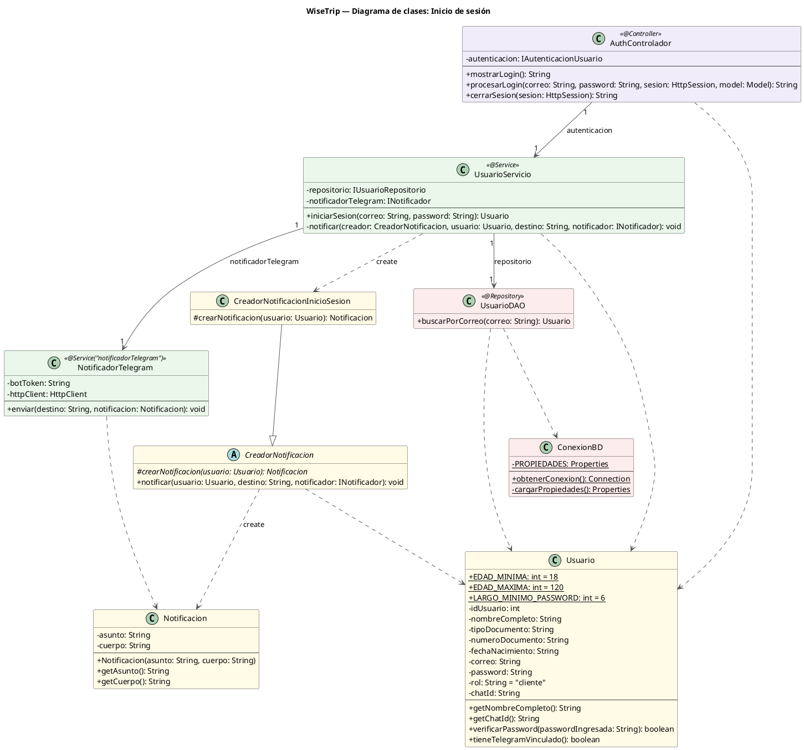

## Diagrama de Clases - inicio de sesion 

### Clases

| Capa | Clase | Responsabilidad |
|---|---|---|
| **Controlador** | `AuthControlador` | Recibe la petición web, llama al servicio y guarda o invalida la sesión; sin lógica propia |
| **Servicio** | `UsuarioServicio` | Coordina el login: busca al usuario en el DAO, pide al `Usuario` verificar la contraseña y envía el aviso; no tiene reglas propias |
| | `NotificadorTelegram` | Envía el mensaje por la API de Telegram usando `HttpClient` |
| **Datos** | `UsuarioDAO` | Busca al usuario por correo |
| | `ConexionBD` | Abre la conexión JDBC a PostgreSQL |
| **Dominio** | `Usuario` | Verifica la contraseña y sabe si tiene Telegram vinculado |
| | `Notificacion` | Guarda el asunto y el cuerpo de un mensaje |
| | `CreadorNotificacion` / `CreadorNotificacionInicioSesion` | Deciden qué mensaje se arma (Factory Method) |

### Relaciones

- **Asociaciones:** `AuthControlador` tiene un `UsuarioServicio`; `UsuarioServicio` tiene un `UsuarioDAO` y un `NotificadorTelegram`.
- **Herencia:** `CreadorNotificacionInicioSesion` extiende `CreadorNotificacion`.
- **Creación:** `UsuarioServicio` crea `CreadorNotificacionInicioSesion`; `CreadorNotificacion` crea la `Notificacion`.
- **Dependencias:** el controlador, el servicio, el DAO y `CreadorNotificacion` usan a `Usuario`; `NotificadorTelegram` usa `Notificacion`; `UsuarioDAO` usa `ConexionBD`.

### Flujo

`POST /login`: `AuthControlador` llama a `iniciarSesion`; `UsuarioServicio` busca al usuario por correo en el DAO y le pregunta al `Usuario` si la contraseña coincide. Si no, devuelve `null` y vuelve al formulario. Si coincide y tiene Telegram vinculado, `NotificadorTelegram` envía el aviso (si falla, el login no se cancela). Luego el controlador guarda la sesión y redirige a `/origen`. `GET /logout` invalida la sesión.

> En el código, el controlador y el servicio no se conectan a las clases directamente sino a interfaces (`IAutenticacionUsuario`, `IUsuarioRepositorio`, `INotificador`), que aquí no se dibujan; por eso los atributos muestran el tipo de la interfaz y las flechas apuntan a la clase que la implementa. `UsuarioServicio` tiene más miembros (registro y vinculación de Telegram) que pertenecen a otros módulos.

## imagen del Diagrama 

## Código del diagrama

