# Diagrama de clases — Control de presupuesto y gastos (M4)

Este diagrama muestra las clases que forman el módulo de Control de Presupuesto y Gastos (M4), con sus atributos, sus métodos principales y cómo se relacionan. Los colores indican la capa de cada clase: morado para los controladores, verde para los servicios y amarillo para los modelos y las clases del patrón Factory Method. En cada flecha se escribe el nombre del atributo que guarda la relación y cuántos objetos participan (`1`, `5`).

La parte de arriba es el flujo de presupuesto y reparto, que hoy funciona en la aplicación. `PlanificacionControlador` recibe el presupuesto del viajero (`Presupuesto`) y lo procesa con su atributo `gestorPresupuesto`. Spring le entrega ahí un `PresupuestoConMargenDecorador`, que aplica el patrón Decorator: guarda el servicio original en `gestorBase` (un `PresupuestoServicio`), le delega todo el trabajo y solo cambia `convertirAUsd()` para sumar un 5% de margen de imprevistos. `PlanControlador` recibe el reparto del presupuesto (`RepartoPresupuesto`, con los porcentajes sugeridos 35/25/20/15/5) y lo valida con `RepartoServicio` a través de su atributo `gestionReparto`. También usa `PresupuestoServicio` directamente para dar formato a los montos.

La parte de abajo es el registro de gastos, que aplica el patrón Factory Method. `GastosServicio` tiene un mapa `CREADORES_CONTROL` con 5 creadores, uno por categoría. `ControlCategoriaCreador` es la clase abstracta (Creator) que declara el método fábrica `crearControl()`. Sus subclases deciden qué control se crea: `CreadorControlEstricto` crea un `ControlCategoriaEstricto`, que bloquea el gasto si supera el cupo de su categoría (hospedaje, alimentación, transporte y actividades), y `CreadorControlFlexible` crea un `ControlCategoriaFlexible`, que solo advierte (imprevistos). Ambos controles implementan `IControlCategoriaGasto` y devuelven un `ResultadoControlCategoria`. Los datos del gasto (`Gasto`) y el resumen final (`ResumenPresupuesto`) son records que no cambian después de crearse.

`GastosServicio` aparece como «pendiente de conexión» porque todavía no tiene `@Service`, ningún controlador lo usa y sus tres repositorios no tienen un DAO que los implemente; hoy solo se ejecuta en `GastosServicioTest`.

## Código PlantUML

```plantuml
@startuml
title WiseTrip — Diagrama de clases: Control de presupuesto y gastos
skinparam classAttributeIconSize 0
skinparam ArrowColor #888888
skinparam nodesep 60
skinparam ranksep 60

' ==================== CONTROLADORES ====================
class PlanificacionControlador <<@Controller>> #EEE8FA {
  -gestorPresupuesto: GestorPresupuesto
  --
  +mostrarPresupuesto(sesion: HttpSession, model: Model): String
  +guardarPresupuesto(presupuesto: Presupuesto, sesion: HttpSession, model: Model): String
  +mostrarResumen(sesion: HttpSession, model: Model): String
}

class PlanControlador <<@Controller>> #EEE8FA {
  -gestionReparto: IGestionReparto
  -presupuestoServicio: PresupuestoServicio
  --
  +mostrarPlan(sesion: HttpSession, model: Model): String
  +guardarPlan(reparto: RepartoPresupuesto, sesion: HttpSession, model: Model): String
  +mostrarViaje(sesion: HttpSession, model: Model): String
}

' ==================== SERVICIOS ====================
class PresupuestoConMargenDecorador <<@Service @Primary>> #E8F5E9 {
  -gestorBase: GestorPresupuesto
  -MARGEN_IMPREVISTOS: double = 1.05
  --
  +validarPresupuesto(presupuesto: Presupuesto, paisDestino: String): Map
  +convertirAUsd(presupuesto: Presupuesto): double
  +formatear(valor: double): String
}

class PresupuestoServicio <<@Service>> #E8F5E9 {
  -MONEDAS: Map<String, String>
  -UNIDADES_POR_USD: Map<String, Double>
  --
  +validarPresupuesto(presupuesto: Presupuesto, paisDestino: String): Map
  +convertirAUsd(presupuesto: Presupuesto): double
  +monedasDisponibles(paisDestino: String): Map
  +formatear(valor: double): String
}

class RepartoServicio <<@Service>> #E8F5E9 {
  -CATEGORIAS: Map<String, String>
  --
  +listarCategorias(): Map
  +validarReparto(reparto: IDistribuible): Map
  +calcularMontos(reparto: IDistribuible, presupuestoTotal: double): Map
}

class GastosServicio <<pendiente de conexión>> #E8F5E9 {
  -CREADORES_CONTROL: Map<String, ControlCategoriaCreador>
  -repositorioGastos: IRepositorioGastos
  -repositorioPresupuesto: IRepositorioPresupuestoViaje
  -repositorioReparto: IRepositorioRepartoPresupuesto
  --
  +validarGasto(idViaje: int, gasto: Gasto): Map
  +registrarGasto(idViaje: int, gasto: Gasto): Gasto
  +consultarResumen(idViaje: int): ResumenPresupuesto
}

' ==================== FACTORY METHOD ====================
abstract class ControlCategoriaCreador #FFF8E1 {
  {abstract} #crearControl(): IControlCategoriaGasto
  +evaluarGasto(gasto: Gasto, cupo: BigDecimal, gastado: BigDecimal): ResultadoControlCategoria
}

class CreadorControlEstricto #FFF8E1 {
  #crearControl(): IControlCategoriaGasto
}

class CreadorControlFlexible #FFF8E1 {
  #crearControl(): IControlCategoriaGasto
}

interface IControlCategoriaGasto #FFF8E1 {
  +evaluar(gasto: Gasto, cupo: BigDecimal, gastado: BigDecimal): ResultadoControlCategoria
}

class ControlCategoriaEstricto #FFF8E1 {
  +evaluar(gasto: Gasto, cupo: BigDecimal, gastado: BigDecimal): ResultadoControlCategoria
}

class ControlCategoriaFlexible #FFF8E1 {
  +evaluar(gasto: Gasto, cupo: BigDecimal, gastado: BigDecimal): ResultadoControlCategoria
}

' ==================== MODELOS ====================
class Presupuesto #FFFDE7 {
  -monto: String
  -moneda: String
  --
  +getMontoNumerico(): double
  +esValido(): boolean
}

class RepartoPresupuesto #FFFDE7 {
  -hospedaje: int = 35
  -alimentacion: int = 25
  -transporte: int = 20
  -actividades: int = 15
  -imprevistos: int = 5
  --
  +getTotal(): int
  +montoDe(categoria: String, total: double): double
}

class Gasto <<record>> #FFFDE7 {
  -categoria: String
  -descripcion: String
  -monto: BigDecimal
  -moneda: String
  -fecha: LocalDate
}

class ResumenPresupuesto <<record>> #FFFDE7 {
  -presupuestoTotal: BigDecimal
  -totalGastado: BigDecimal
  -saldoDisponible: BigDecimal
}

class ResultadoControlCategoria <<record>> #FFFDE7 {
  -excedeCupo: boolean
  -bloqueante: boolean
  -mensaje: String
}

' ==================== RELACIONES ====================

' Controladores -> servicios (el nombre es el atributo que los guarda)
PlanificacionControlador "1" --> "1" PresupuestoConMargenDecorador : gestorPresupuesto
PlanControlador "1" --> "1" RepartoServicio : gestionReparto
PlanControlador "1" --> "1" PresupuestoServicio : presupuestoServicio

' Decorator: envuelve al servicio original
PresupuestoConMargenDecorador "1" --> "1" PresupuestoServicio : gestorBase

' Factory Method
GastosServicio "1" --> "5" ControlCategoriaCreador : CREADORES_CONTROL
CreadorControlEstricto --|> ControlCategoriaCreador
CreadorControlFlexible --|> ControlCategoriaCreador
CreadorControlEstricto ..> ControlCategoriaEstricto : create
CreadorControlFlexible ..> ControlCategoriaFlexible : create
ControlCategoriaEstricto ..|> IControlCategoriaGasto
ControlCategoriaFlexible ..|> IControlCategoriaGasto

' Uso de modelos
PlanificacionControlador ..> Presupuesto
PlanControlador ..> RepartoPresupuesto
GastosServicio ..> Gasto
GastosServicio ..> ResumenPresupuesto : create
IControlCategoriaGasto ..> ResultadoControlCategoria : create

' Ubica la parte de gastos debajo de la de presupuesto (no es una relación)
PresupuestoServicio -[hidden]-> GastosServicio
RepartoServicio -[hidden]-> GastosServicio

@enduml
```

## Diagrama

