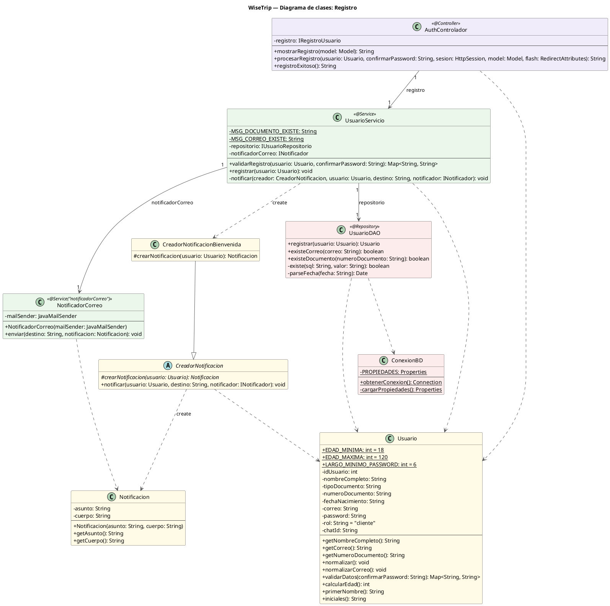

# Diagrama de Clases de Registro

### Clases

| Capa | Clase | Responsabilidad |
|---|---|---|
| **Controlador** | `AuthControlador` | Recibe la petición web, llama al servicio y guarda al usuario en la sesión; sin lógica propia |
| **Servicio** | `UsuarioServicio` | Coordina el registro: valida con `Usuario`, consulta duplicados al DAO y envía la bienvenida; no tiene reglas propias |
| | `NotificadorCorreo` | Envía el mensaje por SMTP usando `JavaMailSender` |
| **Datos** | `UsuarioDAO` | Inserta el usuario y consulta si el correo o el documento ya existen |
| | `ConexionBD` | Abre la conexión JDBC a PostgreSQL |
| **Dominio** | `Usuario` | Se normaliza y se valida (formato, edad mínima de 18, contraseñas) |
| | `Notificacion` | Guarda el asunto y el cuerpo de un mensaje |
| | `CreadorNotificacion` / `CreadorNotificacionBienvenida` | Deciden qué mensaje se arma (Factory Method) |

### Relaciones

- **Asociaciones:** `AuthControlador` tiene un `UsuarioServicio`; `UsuarioServicio` tiene un `UsuarioDAO` y un `NotificadorCorreo`.
- **Herencia:** `CreadorNotificacionBienvenida` extiende `CreadorNotificacion`.
- **Creación:** `UsuarioServicio` crea `CreadorNotificacionBienvenida`; `CreadorNotificacion` crea la `Notificacion`.
- **Dependencias:** el controlador, el servicio, el DAO y `CreadorNotificacion` usan a `Usuario`; `NotificadorCorreo` usa `Notificacion`; `UsuarioDAO` usa `ConexionBD`.

### Flujo

`POST /registro`: `AuthControlador` llama a `validarRegistro`; `UsuarioServicio` valida con `Usuario` y consulta duplicados al DAO. Si hay errores, vuelve al formulario. Si no, `registrar` normaliza al `Usuario`, el DAO lo guarda y `NotificadorCorreo` envía la bienvenida (si falla, el registro no se cancela). Luego el controlador guarda la sesión y redirige a `/registro-exitoso`.

> En el código, el controlador y el servicio no se conectan a las clases directamente sino a interfaces (`IRegistroUsuario`, `IUsuarioRepositorio`, `INotificador`), que aquí no se dibujan; por eso los atributos muestran el tipo de la interfaz y las flechas apuntan a la clase que la implementa. `UsuarioServicio` tiene más miembros (login y Telegram) que pertenecen a otros módulos.

## Imagen del diagrama 

## Codigo del diagrama 

