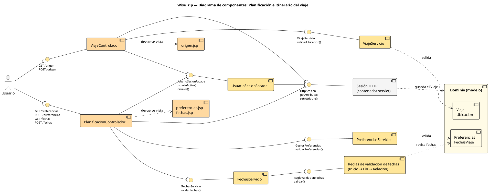

## Diagrama de componentes - Planificación e itinerario del viaje

### Componentes

| Componente | Qué hace |
|---|---|
| `origen.jsp`, `preferencias.jsp`, `fechas.jsp` | Formularios donde el viajero llena su origen, sus preferencias y sus fechas |
| `ViajeControlador` | Recibe el origen, lo valida con el servicio y lo guarda en el `Viaje` de la sesión |
| `PlanificacionControlador` | Recibe las preferencias y las fechas, las valida y las guarda en la sesión HTTP |
| `UsuarioSesionFacade` | Patrón Facade: da el usuario activo de la sesión y sus iniciales para el encabezado |
| `ViajeServicio` | Lista países y ciudades y valida la ubicación de origen |
| `PreferenciasServicio` | Arma el cuestionario de 9 categorías y valida las respuestas |
| `FechasServicio` | Valida las fechas y calcula la duración del viaje |
| Reglas de validación de fechas | Patrón Chain of Responsibility: `ReglaFechaInicio` → `ReglaFechaFin` → `ReglaRelacionFechas` (máximo 60 días) |
| Dominio (modelo) | `Viaje`, `Ubicacion`, `Preferencias` y `FechasViaje`: los datos del viaje |
| Sesión HTTP | Guarda el `Viaje` y las respuestas mientras el viajero sigue el flujo |

### Interfaces

| Interfaz | Entre | Operaciones |
|---|---|---|
| HTTP origen | Usuario → `ViajeControlador` | `GET /origen`, `POST /origen` |
| HTTP planificación | Usuario → `PlanificacionControlador` | `GET /preferencias`, `POST /preferencias`, `GET /fechas`, `POST /fechas` |
| `IViajeServicio` | `ViajeControlador` → `ViajeServicio` | `listarPaises()`, `listarCiudades()`, `validarUbicacion()` |
| `GestorPreferencias` | `PlanificacionControlador` → `PreferenciasServicio` | `listarCategorias()`, `validarPreferencias()`, `resumenPorCategoria()` |
| `IFechasServicio` | `PlanificacionControlador` → `FechasServicio` | `validarFechas()`, `calcularDuracion()`, `hoy()` |
| `ReglaValidacionFechas` | `FechasServicio` → Reglas de validación | `validar()` |
| `UsuarioSesionFacade` | Los dos controladores → fachada | `usuarioActivo()`, `iniciales()`, `prepararEncabezado()` |
| `HttpSession` | Controladores y fachada → sesión HTTP | `getAttribute()`, `setAttribute()` |

### Flujo

Usuario → `origen.jsp` → `ViajeControlador` → `ViajeServicio` (valida la ubicación) → el origen queda en el `Viaje` de la sesión. Después, Usuario → `preferencias.jsp` → `PlanificacionControlador` → `PreferenciasServicio`, y Usuario → `fechas.jsp` → `PlanificacionControlador` → `FechasServicio` → cadena de reglas. En todas las pantallas, el controlador pide a `UsuarioSesionFacade` el usuario y sus iniciales. Este módulo no usa base de datos: todo queda en la sesión HTTP hasta que otros módulos lo usen.

## Imagen del diagrama de componentes

(aquí va la imagen)

## Codigo del diagrama

## Diagrama

