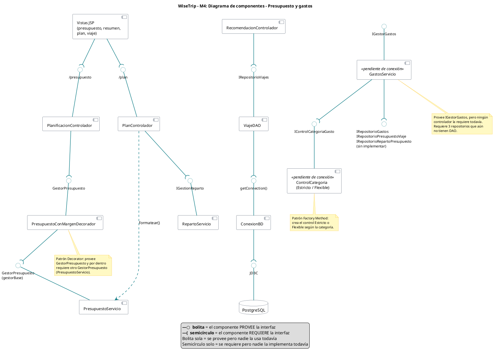

# Diagrama de componentes — Control de presupuesto y gastos (M4)

Este diagrama muestra las piezas que forman el módulo de Control de Presupuesto y Gastos (M4) y la interfaz por la que se comunica cada una con las demás. No muestra atributos ni métodos: lo importante aquí es quién ofrece un servicio, quién lo necesita y cómo se conectan, desde las vistas JSP hasta la base de datos PostgreSQL.

Cada interfaz se dibuja entre dos componentes. La bolita (○) va unida al componente que la provee, es decir, el que la implementa. El semicírculo va unido al componente que la requiere, es decir, el que la usa. Cuando la bolita queda dentro del semicírculo, los dos componentes están conectados. Por ejemplo, `PlanificacionControlador` requiere `GestorPresupuesto` y `PresupuestoConMargenDecorador` la provee; a la vez, el decorador requiere otro `GestorPresupuesto` (el `gestorBase`), que provee `PresupuestoServicio`. Esa cadena es el patrón Decorator: el decorador ofrece la misma interfaz que el objeto que envuelve y le agrega un 5% de margen de imprevistos al convertir el presupuesto a USD.

El flujo que hoy funciona en la aplicación es este. El viajero envía su presupuesto desde `presupuesto.jsp` y su reparto por categorías desde `plan.jsp`. `PlanificacionControlador` y `PlanControlador` los validan mediante `GestorPresupuesto` e `IGestionReparto` y los guardan en la sesión. Después, `RecomendacionControlador` usa `IRepositorioViajes` para guardar el viaje con su presupuesto en USD, pasando por `ViajeDAO`, `ConexionBD` y JDBC hasta PostgreSQL.

La parte de gastos aparece con el estereotipo «pendiente de conexión». `GastosServicio` provee `IGestorGastos`, pero ningún controlador la requiere todavía (bolita sola). También requiere tres repositorios que aún no tienen DAO (semicírculo sin bolita). Para decidir si un gasto que se pasa del cupo se bloquea o solo se advierte, usa el patrón Factory Method a través de `IControlCategoriaGasto`. Hoy esta parte solo se ejecuta en `GastosServicioTest`.

## Código PlantUML

## Diagrama

