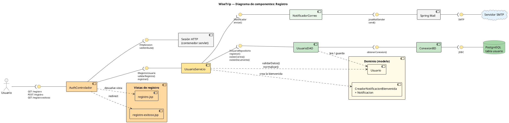

## Diagrama de componentes — Registro

### Componentes

| Componente | Qué hace |
|---|---|
| `registro.jsp`, `registro-exitoso.jsp` | Vistas del formulario y de la confirmación |
| `AuthControlador` | Recibe la petición web, llama al contrato de registro y guarda al usuario en la sesión HTTP |
| `UsuarioServicio` | Coordina el registro: valida con `Usuario`, consulta al repositorio y envía la bienvenida |
| Dominio (modelo) | `Usuario` (reglas y validaciones) y `CreadorNotificacionBienvenida` + `Notificacion` (el mensaje) |
| `UsuarioDAO` | Guarda el usuario y comprueba si el correo o el documento ya existen |
| `ConexionBD` | Abre la conexión JDBC a PostgreSQL |
| `NotificadorCorreo` | Envía la bienvenida usando Spring Mail y el servidor SMTP |

### Interfaces

| Interfaz | Entre | Operaciones |
|---|---|---|
| HTTP | Usuario → `AuthControlador` | `GET /registro`, `POST /registro`, `GET /registro-exitoso` |
| `IRegistroUsuario` | `AuthControlador` → `UsuarioServicio` | `validarRegistro()`, `registrar()` |
| `IUsuarioRepositorio` | `UsuarioServicio` → `UsuarioDAO` | `registrar()`, `existeCorreo()`, `existeDocumento()` |
| `INotificador` | `UsuarioServicio` → `NotificadorCorreo` | `enviar()` |
| `JavaMailSender` | `NotificadorCorreo` → Spring Mail | `send()` |
| `HttpSession` | `AuthControlador` → sesión HTTP | `setAttribute()` |

### Flujo

Usuario → `registro.jsp` → `AuthControlador` → `UsuarioServicio` → `UsuarioDAO` → `ConexionBD` → PostgreSQL. Después del guardado, `UsuarioServicio` → `NotificadorCorreo` → Spring Mail → servidor SMTP, y el controlador redirige a `registro-exitoso.jsp`.

# Foto del diagrama 

## Codigo del diagrama

