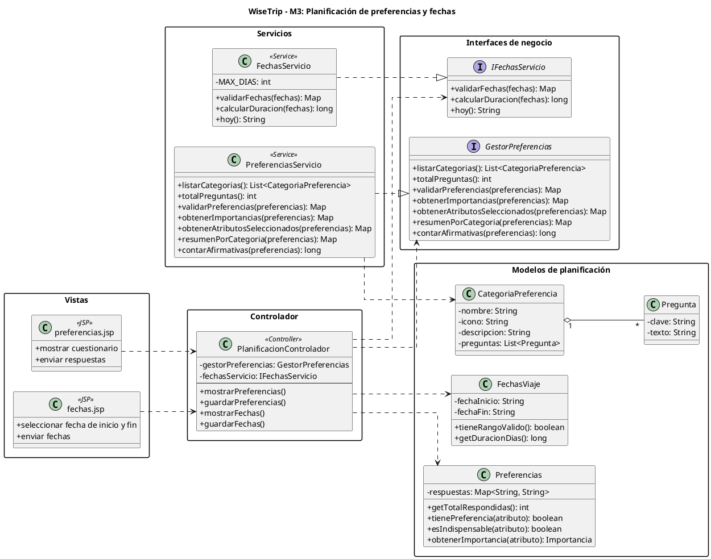

# Diagrama de interfaces — Planificación de preferencias y fechas (M3)

Este diagrama muestra las interfaces de negocio creadas para el módulo de Planificación e Itinerario del Viaje (M3), en respuesta a la observación de que el proyecto no tenía interfaces reales de negocio (solo las anotaciones propias de Spring Boot).

Se definieron dos interfaces: `IFechasServicio` y `GestorPreferencias`, cada una implementada por su respectivo servicio (`FechasServicio` y `PreferenciasServicio`). El controlador (`PlanificacionControlador`) depende de estas interfaces y no de las clases concretas, siguiendo el principio de inversión de dependencias: si el equipo cambia cómo se valida una fecha o cómo se procesan las preferencias por dentro, el controlador no se entera ni se rompe, mientras el contrato de la interfaz se mantenga.

El diagrama también incluye las clases de dominio relacionadas (`CategoriaPreferencia`, `Pregunta`, `FechasViaje`, `Preferencias`), que ya no son solo atributos: tienen comportamiento propio como `tieneRangoValido()`, `getDuracionDias()`, `tienePreferencia()` y `esIndispensable()`. Por último se muestran las vistas (`fechas.jsp`, `preferencias.jsp`) que inician el flujo desde el lado del usuario.

## Código PlantUML

## Imagen

