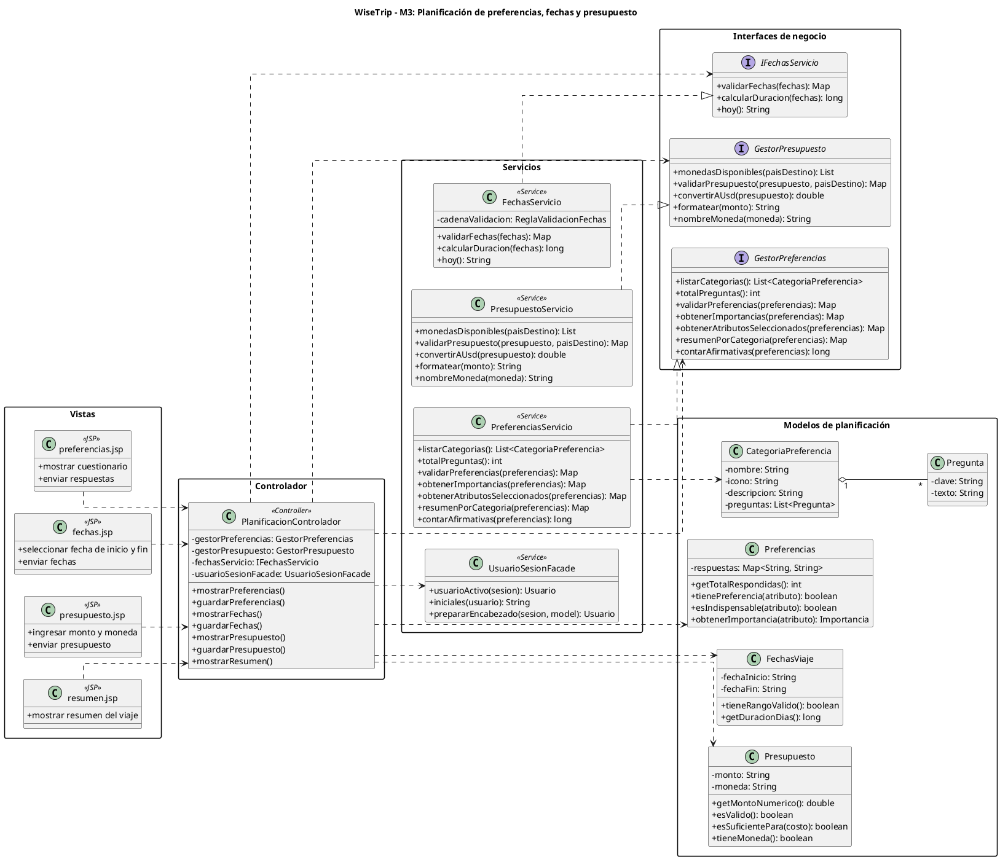

# Diagrama de interfaces — Planificación de preferencias, fechas y presupuesto (Módulo 3)

Este diagrama muestra las interfaces de negocio del módulo de Planificación e Itinerario del Viaje (M3), creadas en respuesta a la observación de que el proyecto no tenía interfaces reales de negocio (solo las anotaciones propias de Spring Boot).

El controlador `PlanificacionControlador` depende de tres interfaces: `GestorPreferencias`, `IFechasServicio` y `GestorPresupuesto`. Cada una la implementa su servicio (`PreferenciasServicio`, `FechasServicio` y `PresupuestoServicio`). El controlador no conoce las clases concretas, siguiendo el principio de inversión de dependencias: si el equipo cambia cómo se valida una fecha o cómo se procesan las preferencias por dentro, el controlador no se entera ni se rompe, mientras el contrato de la interfaz se mantenga. De `GestorPresupuesto` solo se muestran los métodos que usa este controlador, porque la interfaz completa pertenece al módulo de presupuesto y gastos.

Además, el controlador usa `UsuarioSesionFacade` para obtener el usuario de la sesión y sus iniciales, en vez de repetir ese código en cada método. `FechasServicio` valida las fechas con una cadena de reglas, que se explica en el documento de patrones GoF del módulo.

El diagrama también incluye las clases de dominio relacionadas (`CategoriaPreferencia`, `Pregunta`, `FechasViaje`, `Preferencias` y `Presupuesto`), que tienen comportamiento propio como `tieneRangoValido()`, `getDuracionDias()`, `tienePreferencia()` y `esIndispensable()`. Por último se muestran las vistas (`preferencias.jsp`, `fechas.jsp`, `presupuesto.jsp` y `resumen.jsp`) que inician el flujo desde el lado del usuario.

## Código PlantUML

## Imagen

