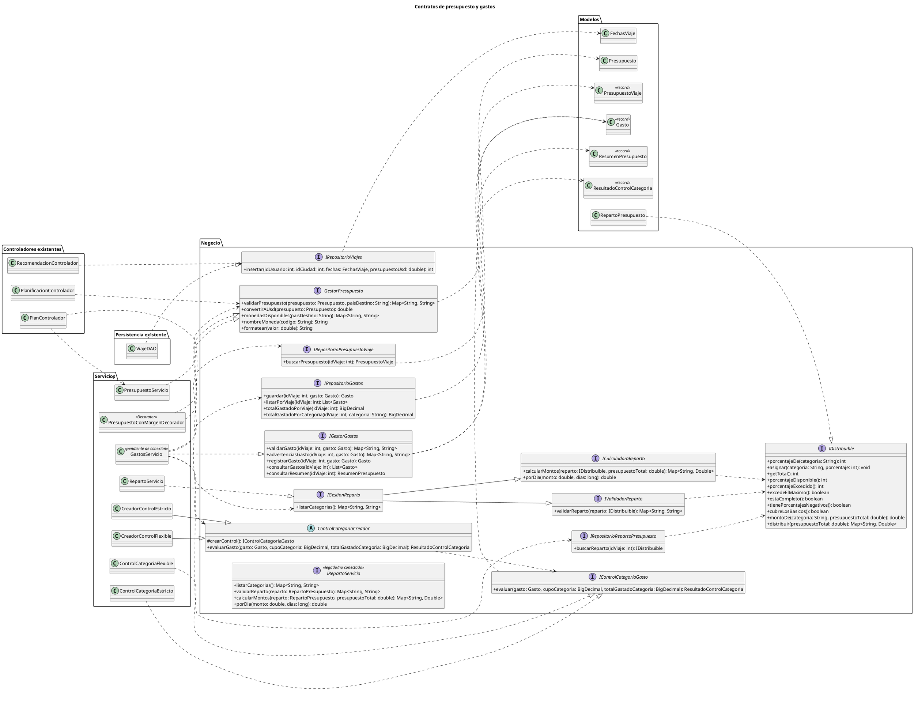

# Diagrama de interfaces — Control de presupuesto y gastos (M4)

Este diagrama muestra las interfaces de negocio del módulo de Control de Presupuesto y Gastos (M4), qué clase implementa cada una y quién depende de ellas. Una interfaz define qué se puede hacer (sus métodos), pero no cómo se hace; eso lo decide la clase que la implementa. Los controladores y servicios dependen de estos contratos y no de clases concretas, siguiendo el principio de inversión de dependencias: si el equipo cambia cómo se valida un presupuesto o cómo se controla un gasto, quien usa la interfaz no se entera ni se rompe, mientras el contrato se mantenga.

`GestorPresupuesto` la implementan dos clases: `PresupuestoServicio` y `PresupuestoConMargenDecorador`. Así funciona el patrón Decorator: `PlanificacionControlador` pide un `GestorPresupuesto` y no sabe si recibe el servicio original o el decorado, que suma un 5% de margen de imprevistos al convertir a USD. Para el reparto se aplicó el principio de segregación de interfaces. `IValidadorReparto` (validar) e `ICalculadoraReparto` (calcular montos) son contratos pequeños y separados, que `IGestionReparto` hereda y `RepartoServicio` implementa. `IDistribuible` la implementa el modelo `RepartoPresupuesto` y trae métodos `default`, así que la clase solo debe completar los tres métodos básicos.

Para los gastos, `IGestorGastos` la implementa `GastosServicio`, que depende de tres repositorios (`IRepositorioGastos`, `IRepositorioPresupuestoViaje` e `IRepositorioRepartoPresupuesto`). Estos repositorios todavía no tienen un DAO que los implemente; por eso `GastosServicio` aparece como «pendiente de conexión». Para controlar el cupo de cada categoría se usa el patrón Factory Method: la clase abstracta `ControlCategoriaCreador` (Creator), heredada por `CreadorControlEstricto` y `CreadorControlFlexible`, crea objetos de tipo `IControlCategoriaGasto` (Product), implementada por `ControlCategoriaEstricto` y `ControlCategoriaFlexible`.

Por último, `IRepositorioViajes` la implementa `ViajeDAO` y la usa `RecomendacionControlador` para guardar el viaje con su presupuesto en USD. El paquete Modelos agrupa las clases y records de datos que reciben o devuelven los contratos. `IRepartoServicio` se conserva marcada como «legado/no conectado», porque nadie la implementa ni la usa: es una versión vieja de `IGestionReparto`.

## Código PlantUML

## Diagrama

