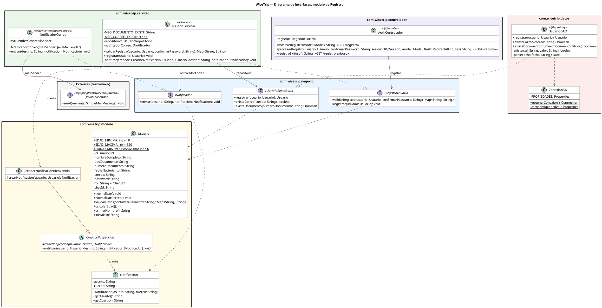

## Cómo funciona el módulo de registro

El dominio (lo que el negocio sabe hacer) está separado de la tecnología que lo ejecuta (Spring, base de datos, correo). Las capas se comunican por **interfaces**, así que ninguna depende de cómo está hecha la otra.

### Qué hace cada pieza

| Capa | Pieza | Qué hace |
|---|---|---|
| **Dominio** | `Usuario` | Conoce sus reglas: se normaliza y se valida (formato, edad, contraseñas) |
| | `Notificacion` | Guarda el asunto y el cuerpo de un mensaje |
| | `CreadorNotificacion` / `CreadorNotificacionBienvenida` | Deciden qué mensaje se arma (Factory Method) |
| **Contratos** | `IRegistroUsuario` | Validar y registrar un usuario |
| | `IUsuarioRepositorio` | Guardar usuarios y comprobar si ya existen |
| | `INotificador` | Enviar un mensaje por un canal |
| **Servicio** | `UsuarioServicio` | Coordina; no tiene reglas propias |
| | `NotificadorCorreo` | Envía el mensaje por SMTP |
| **Datos** | `UsuarioDAO`, `ConexionBD` | Guardan en la base de datos y abren la conexión |
| **Controlador** | `AuthControlador` | Recibe la petición web y llama al contrato, sin lógica propia |

### Flujo (`POST /registro`)

1. `AuthControlador` llama a `validarRegistro`.
2. `UsuarioServicio` le pide al `Usuario` que se valide y consulta al repositorio si el correo o el documento ya existen.
3. Si hay errores, se vuelve al formulario con los mensajes.
4. Si no hay errores, `registrar` normaliza al `Usuario`, el DAO lo guarda y `NotificadorCorreo` envía la bienvenida. Si el correo falla, el registro no se cancela.
5. El controlador guarda al usuario en la sesión y redirige a `/registro-exitoso`.

### Decisiones de diseño

- **Dominio sin tecnología:** `Usuario` no sabe de base de datos ni de correo.
- **Servicio que solo coordina:** las reglas viven en `Usuario`, no en `UsuarioServicio`.
- **Interfaces como contratos:** el controlador depende de `IRegistroUsuario`, no de `UsuarioServicio`, y el servicio depende de `IUsuarioRepositorio`, no de JDBC. Se puede cambiar una implementación sin tocar quien la usa.
- **Canal nuevo, clase nueva:** para enviar por otro medio (por ejemplo SMS) basta con otra clase que implemente `INotificador`.
- **Qué se dice vs. por dónde se envía:** el contenido del mensaje es del negocio (`Creador…` y `Notificacion`); el canal es tecnología (`NotificadorCorreo`).

##Diagrama de interfaces 

